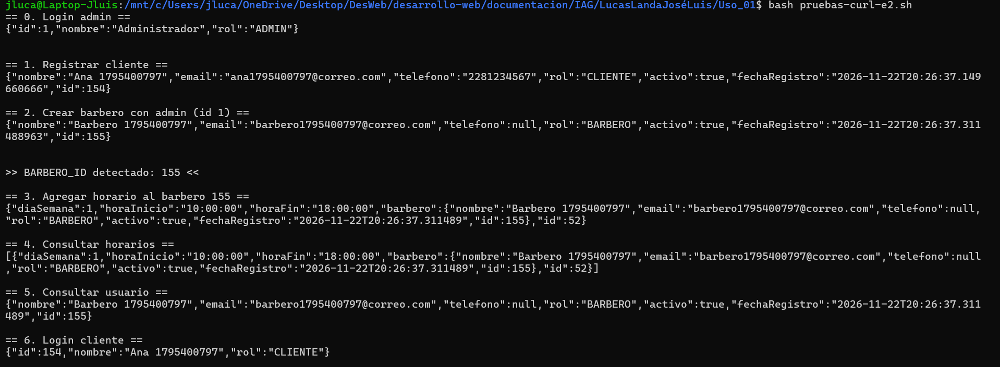

# r-ia-dev - Jose Luis Lucas Landa - Script de pruebas cURL E2 (2026-11-12)

> Declaración de la generación del archivo de pruebas `pruebas-curl-e2.sh`
> (pruebas cURL del E2: usuarios y horarios). Formato alineado con la
> plantilla verificada el 2026-11-13 en
> https://github.com/tareasR/desarrollo-web/tree/main/documentacion
> (documentacion/r-ia-dev-zz.md). Un reporte por archivo de pruebas, con la
> sesión y el prompt reales de cada uno.

| Evidencia | Formato / Contenido |
|---|---|
| Herramienta | Muse Spark, Meta |
| Modelo / temperatura | Muse Spark / no aplica |
| Descripcion de la intencion general | Generar el script de pruebas cURL del E2 (camino feliz + errores) para probar el backend de usuarios y horarios con el cliente cURL, el método base del curso. |
| Prompt original | "Dame las pruebas con curl en un solo archivo para poder probar todo lo que tenemos hasta el momento |
| Respuesta de IA | `pruebas-curl-e2.sh`: caso 0 login admin, 1 registro de cliente, 2 crear barbero con admin, 3 crear horario, 4 listar horarios, 5 consultar usuario, 6 login cliente. Imprime cada respuesta; los códigos se ven con `curl -i` (201, 200, 401, 403, 404, 409). El id del admin sale del login (ajuste del 2026-11-22 al armar el set por avance; antes se asumía 1). |
| Codigo anterior | (No existía el archivo.) |
| Codigo posterior | `pruebas-curl-e2.sh` (en `documentacion/IAG/LucasLandaJoseLuis/Uso_01/`, entregado el 2026-11-12; aún no subido a main). |
| Diferencias entre versiones | Archivo nuevo; no hay `git diff --numstat` porque no está commiteado en main. |
| Prueba de funcionamiento | CURL. Lel script solo se revisó con `bash -n`. Corrida en WSL con MySQL, resultado abajo. |
| Codigo de uso | Pruebas |
| Reflexion del estudiante | Se obtuvo el script pruebas-curl-e2.sh para automatizar y verificar el backend de usuarios y horarios mediante cURL, cubriendo el flujo exitoso y escenarios de error. Aprendí a estructurar pruebas repetibles con cURL, a extraer dinámicamente el ID del administrador desde el login en lugar de asumirlo y a validar la sintaxis del script antes de ejecutarlo |


## Evidencia de la corrida en WSL

Todos los casos OK: login admin (id 1), cliente creado (id 154), barbero
creado con admin (id 155), horario creado (id 52, lunes 10:00-18:00),
lista de horarios con el horario, consulta del usuario y login del cliente.



```
== 0. Login admin ==
{"id":1,"nombre":"Administrador","rol":"ADMIN"}

== 1. Registrar cliente ==
{"nombre":"Ana 1795400797","email":"ana1795400797@correo.com","telefono":"2281234567","rol":"CLIENTE","activo":true,"fechaRegistro":"2026-11-22T20:26:37.149660666","id":154}

== 2. Crear barbero con admin (id 1) ==
{"nombre":"Barbero 1795400797","email":"barbero1795400797@correo.com","telefono":null,"rol":"BARBERO","activo":true,"fechaRegistro":"2026-11-22T20:26:37.311488963","id":155}

>> BARBERO_ID detectado: 155 <<

== 3. Agregar horario al barbero 155 ==
{"diaSemana":1,"horaInicio":"10:00:00","horaFin":"18:00:00","barbero":{"nombre":"Barbero 1795400797","email":"barbero1795400797@correo.com","telefono":null,"rol":"BARBERO","activo":true,"fechaRegistro":"2026-11-22T20:26:37.311489","id":155},"id":52}

== 4. Consultar horarios ==
[{"diaSemana":1,"horaInicio":"10:00:00","horaFin":"18:00:00","barbero":{"nombre":"Barbero 1795400797","email":"barbero1795400797@correo.com","telefono":null,"rol":"BARBERO","activo":true,"fechaRegistro":"2026-11-22T20:26:37.311489","id":155},"id":52}]

== 5. Consultar usuario ==
{"nombre":"Barbero 1795400797","email":"barbero1795400797@correo.com","telefono":null,"rol":"BARBERO","activo":true,"fechaRegistro":"2026-11-22T20:26:37.311489","id":155}

== 6. Login cliente ==
{"id":154,"nombre":"Ana 1795400797","rol":"CLIENTE"}
```