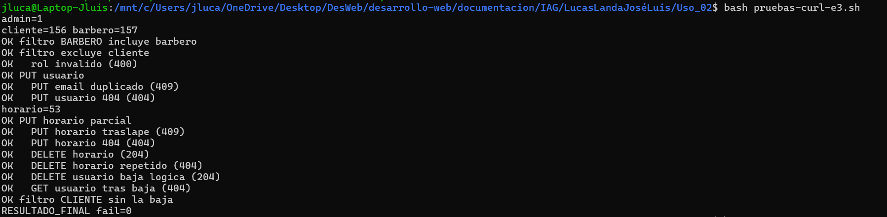

# r-ia-dev - Jose Luis Lucas Landa - Script de pruebas cURL E3 (2026-11-16)

> Declaración de la generación del archivo de pruebas `pruebas-curl-e3.sh`
> (pruebas cURL del E3: PUT/DELETE y filtro por rol). Formato alineado con
> la plantilla verificada el 2026-11-13 en
> https://github.com/tareasR/desarrollo-web/tree/main/documentacion
> (documentacion/r-ia-dev-zz.md). Un reporte por archivo de pruebas, con la
> sesión y el prompt reales de cada uno.

| Evidencia | Formato / Contenido |
|---|---|
| Herramienta | Muse Spark, Meta |
| Modelo / temperatura | Muse Spark / no aplica |
| Descripcion de la intencion general | Generar el script de pruebas cURL del E3 para probar PUT y DELETE y el filtro por rol en usuarios y horarios, con el código esperado en cada caso. |
| Prompt original | Genera las pruebas curl para lo siguiente: Reparto E3, parte de José Luis (PUT/DELETE y filtro por rol en usuarios y
horarios), y las pruebas cURL propias como parte de esa entrega. |
| Respuesta de IA | `pruebas-curl-e3.sh`: función `check` con el código esperado y `RESULTADO_FINAL fail=0/1`. Cubre filtro `?rol=BARBERO` (incluye barbero, excluye cliente), rol inválido 400, PUT usuario 200, PUT con email duplicado 409, PUT usuario 404, PUT horario parcial, traslape 409, PUT horario 404, DELETE horario 204 y repetido 404, DELETE usuario (baja lógica) 204, GET tras baja 404 y filtro CLIENTE sin la baja. El id del admin sale del login (ajuste del 2026-11-22 al armar el set por avance; antes se asumía 1). |
| Codigo anterior | (No existía el archivo.) |
| Codigo posterior | `pruebas-curl-e3.sh` (en `documentacion/IAG/LucasLandaJoseLuis/Uso_02/`, entregado el 2026-11-16; aún no subido a main). |
| Diferencias entre versiones | Archivo nuevo; no hay `git diff --numstat` porque no está commiteado en main. |
| Prueba de funcionamiento | CURL. Corrida en WSL con MySQL real, todos los casos OK (`RESULTADO_FINAL fail=0`; ver evidencia abajo) |
| Codigo de uso | Pruebas |
| Reflexion del estudiante | Se obtuvo y ejecutó con éxito el script pruebas-curl-e3.sh en WSL contra MySQL real (RESULTADO_FINAL fail=0), validando el filtrado por rol así como operaciones PUT y DELETE en usuarios y horarios con sus códigos HTTP esperados. Aprendí a estructurar aserciones automatizadas de códigos HTTP con un resumen final de fallos, a obtener dinámicamente el ID del administrador desde el login y a verificar reglas de negocio críticas como traslapes, unicidad de correo y bajas lógicas sobre datos reales. |

## Evidencia de la corrida en WSL

Todos los casos OK: `RESULTADO_FINAL fail=0` (admin id 1, cliente id 156,
barbero id 157, horario id 53).



```
admin=1
cliente=156 barbero=157
OK filtro BARBERO incluye barbero
OK filtro excluye cliente
OK rol invalido (400)
OK PUT usuario
OK PUT email duplicado (409)
OK PUT usuario 404 (404)
horario=53
OK PUT horario parcial
OK PUT horario traslape (409)
OK PUT horario 404 (404)
OK DELETE horario (204)
OK DELETE horario repetido (404)
OK DELETE usuario baja logica (204)
OK GET usuario tras baja (404)
OK filtro CLIENTE sin la baja
RESULTADO_FINAL fail=0
```