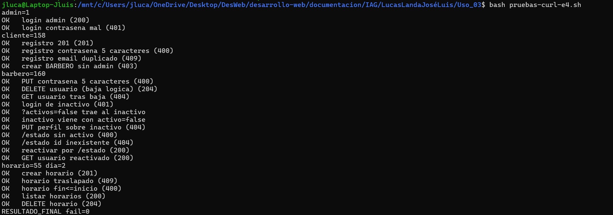

# r-ia-dev - Jose Luis Lucas Landa - Script de pruebas cURL E4 (2026-11-22)

> Declaración de la generación del archivo de pruebas `pruebas-curl-e4.sh`
> (pruebas cURL del E4: activar/desactivar y contraseña mínima de 6).
> Formato alineado con la plantilla verificada el 2026-11-13 en
> https://github.com/tareasR/desarrollo-web/tree/main/documentacion
> (documentacion/r-ia-dev-zz.md). Un reporte por archivo de pruebas, con la
> sesión y el prompt reales de cada uno.

| Evidencia | Formato / Contenido |
|---|---|
| Herramienta | Muse Spark, Meta |
| Modelo / temperatura | Muse Spark / no aplica |
| Descripcion de la intencion general | Generar el script de pruebas cURL del E4, en su propio archivo separado por avance, para probar activar/desactivar por `/estado`, `?activos=false` y la regla de contraseña mínima de 6 caracteres. |
| Prompt original | "Dame las purbas curl para estos casos: Uso_03 (E4):

El login entra con datos correctos y falla con contraseña incorrecta
El registro crea el usuario
El registro rechaza contraseñas de menos de 6 caracteres
El registro rechaza correos ya registrados
Crear un barbero sin ser admin se rechaza
Cambiar la contraseña por una corta se rechaza
Desactivar un usuario lo saca de la lista y ya no puede entrar
La lista con inactivos sí muestra al desactivado
Reactivar lo devuelve y ya se puede ver
Crear horario, que no se traslape con otro y que la hora de fin sea mayor que la de inicio
Listar y eliminar horarios." |
| Respuesta de IA | `pruebas-curl-e4.sh`: 20 casos con función `check` y `RESULTADO_FINAL fail=0/1`. Cubre login admin 200 y con contraseña mal 401, registro 201, registro con contraseña de 5 caracteres 400, email duplicado 409, crear BARBERO sin admin 403, PUT con contraseña de 5 caracteres 400, DELETE (baja lógica) 204, GET tras baja 404, login de inactivo 401, `?activos=false` con el inactivo y `"activo":false`, PUT de perfil sobre inactivo 404, `/estado` sin `activo` 400, `/estado` con id inexistente 404, reactivar por `/estado` 200, GET del reactivado 200, y horarios: crear 201, traslape 409, fin menor o igual que inicio 400, listar 200, DELETE 204. Los correos llevan marca de tiempo y el día del horario varía, así que se puede repetir. |
| Codigo anterior | (No existía el archivo.) |
| Codigo posterior | `pruebas-curl-e4.sh` (en `documentacion/IAG/LucasLandaJoseLuis/Uso_03/`, entregado el 2026-11-22; aún no subido a main). |
| Diferencias entre versiones | Archivo nuevo; no hay `git diff --numstat` porque no está commiteado en main. |
| Prueba de funcionamiento | CURL. Corrida en WSL con MySQL real, todos los casos OK (`RESULTADO_FINAL fail=0`; ver evidencia abajo). |
| Codigo de uso | Pruebas |
| Reflexion del estudiante | Se obtuvo y validó en WSL contra MySQL real el script `pruebas-curl-e4.sh`, cubriendo autenticación, registro, roles, gestión de estado, consulta con `?activos=false`, longitud mínima de contraseña y horarios con sus códigos HTTP esperados. Aprendí a diseñar suites de pruebas repetibles con datos dinámicos (correos con marca de tiempo y días variables), verificar transiciones de estado y reglas de validación tanto en usuarios como en horarios, y confirmar su comportamiento real en base de datos. |


## Evidencia de la corrida en WSL

Todos los casos OK: `RESULTADO_FINAL fail=0` (admin id 1, cliente id 158,
barbero id 160, horario id 55, día 2).



```
admin=1
OK login admin (200)
OK login contrasena mal (401)
cliente=158
OK registro 201 (201)
OK registro contrasena 5 caracteres (400)
OK registro email duplicado (409)
OK crear BARBERO sin admin (403)
barbero=160
OK PUT contrasena 5 caracteres (400)
OK DELETE usuario (baja logica) (204)
OK GET usuario tras baja (404)
OK login de inactivo (401)
OK ?activos=false trae al inactivo
OK inactivo viene con activo=false
OK PUT perfil sobre inactivo (404)
OK /estado sin activo (400)
OK /estado id inexistente (404)
OK reactivar por /estado (200)
OK GET usuario reactivado (200)
horario=55 dia=2
OK crear horario (201)
OK horario traslapado (409)
OK horario fin<=inicio (400)
OK listar horarios (200)
OK DELETE horario (204)
RESULTADO_FINAL fail=0
```