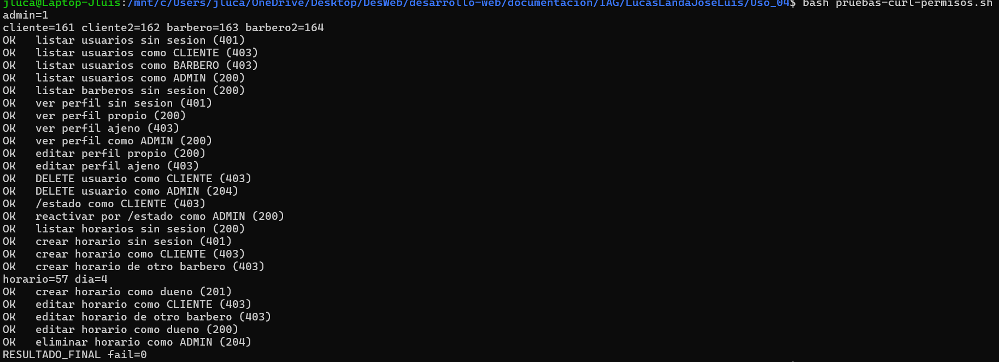

# r-ia-dev - Jose Luis Lucas Landa - Script de pruebas cURL permisos (2026-11-22)

> Declaración de la generación del archivo de pruebas
> `pruebas-curl-permisos.sh` (pruebas cURL de permisos por rol: 401 sin
> sesión, 403 sin permiso). Formato alineado con la plantilla verificada
> el 2026-11-13 en
> https://github.com/tareasR/desarrollo-web/tree/main/documentacion
> (documentacion/r-ia-dev-zz.md). Un reporte por archivo de pruebas, con la
> sesión y el prompt reales de cada uno.

| Evidencia | Formato / Contenido |
|---|---|
| Herramienta | Muse Spark, Meta |
| Modelo / temperatura | Muse Spark / no aplica |
| Descripcion de la intencion general | Generar el script de pruebas cURL de los permisos por rol, en su propio archivo separado por avance, para probar el 401 sin sesión y el 403 sin permiso en usuarios y horarios. |
| Prompt original | "Dame las pruebas curl para estos casos:Uso_04 (permisos):

Sin sesión no se puede listar usuarios
Como cliente o barbero tampoco se puede; solo el admin
La lista de barberos está abierta sin sesión
Ver el perfil propio sí, el de otro no, sin sesión no
Editar el perfil propio sí, el de otro no
Desactivar como cliente no; como admin sí
Reactivar como cliente no; como admin sí
Horarios: verlos sin sesión sí; crearlos sin sesión no, como cliente no, de otro barbero no, como dueño sí
Editar horarios como cliente no, de otro barbero no, como dueño sí
Eliminar horarios como admin sí" |
| Respuesta de IA | `pruebas-curl-permisos.sh`: 24 casos con función `check` y `RESULTADO_FINAL fail=0/1`. Cubre listar usuarios sin sesión 401, como CLIENTE 403, como BARBERO 403 y como ADMIN 200; `?rol=BARBERO` sin sesión 200 (sigue abierto); ver perfil sin sesión 401, propio 200, ajeno 403 y como ADMIN 200; editar perfil propio 200 y ajeno 403; DELETE como CLIENTE 403 y como ADMIN 204; `/estado` como CLIENTE 403 y reactivar como ADMIN 200; horarios: listar sin sesión 200, crear sin sesión 401, como CLIENTE 403, de otro barbero 403 y como dueño 201, editar como CLIENTE 403, de otro barbero 403 y como dueño 200, eliminar como ADMIN 204. Los correos llevan marca de tiempo y el día del horario varía, así que se puede repetir. |
| Codigo anterior | (No existía el archivo.) |
| Codigo posterior | `pruebas-curl-permisos.sh` (en `documentacion/IAG/LucasLandaJoseLuis/Uso_04/`, entregado el 2026-11-22; aún no subido a main). |
| Diferencias entre versiones | Archivo nuevo; no hay `git diff --numstat` porque no está commiteado en main. |
| Prueba de funcionamiento | CURL. Corrida en WSL con MySQL real, todos los casos OK (`RESULTADO_FINAL fail=0`; ver evidencia abajo). |
| Codigo de uso | Pruebas |
| Reflexion del estudiante | Se obtuvo y validó en WSL contra MySQL real el script `pruebas-curl-permisos.sh`, cubriendo las reglas de autorización por rol y propiedad de recursos en usuarios y horarios: al listar usuarios, ver perfil o crear horario sin sesión, al intentar listar usuarios como `CLIENTE` o `BARBERO`, ver o editar perfil ajeno, desactivar/reactivar o eliminar usuarios como `CLIENTE`, o crear/editar horarios como `CLIENTE` o en nombre de otro barbero, al listar barberos y horarios sin sesión, listar usuarios como `ADMIN`, consultar/editar perfil propio, consultar perfil como `ADMIN`, reactivar usuario como `ADMIN` o editar horario como dueño, al crear horario como dueño; y al eliminar usuario o horario como `ADMIN`. Aprendí a verificar explícitamente tanto la autenticación (`401`) como el control de acceso basado en roles y pertenencia (`403` vs `200`/`201`/`204`) en endpoints sensibles, asegurando que las operaciones críticas queden restringidas al rol o recurso correspondiente. |

## Evidencia de la corrida en WSL

Todos los casos OK: `RESULTADO_FINAL fail=0` (admin id 1, cliente id 161,
cliente2 id 162, barbero id 163, barbero2 id 164, horario id 57, día 4).



```
admin=1
cliente=161 cliente2=162 barbero=163 barbero2=164
OK listar usuarios sin sesion (401)
OK listar usuarios como CLIENTE (403)
OK listar usuarios como BARBERO (403)
OK listar usuarios como ADMIN (200)
OK listar barberos sin sesion (200)
OK ver perfil sin sesion (401)
OK ver perfil propio (200)
OK ver perfil ajeno (403)
OK ver perfil como ADMIN (200)
OK editar perfil propio (200)
OK editar perfil ajeno (403)
OK DELETE usuario como CLIENTE (403)
OK DELETE usuario como ADMIN (204)
OK /estado como CLIENTE (403)
OK reactivar por /estado como ADMIN (200)
OK listar horarios sin sesion (200)
OK crear horario sin sesion (401)
OK crear horario como CLIENTE (403)
OK crear horario de otro barbero (403)
horario=57 dia=4
OK crear horario como dueno (201)
OK editar horario como CLIENTE (403)
OK editar horario de otro barbero (403)
OK editar horario como dueno (200)
OK eliminar horario como ADMIN (204)
RESULTADO_FINAL fail=0
```